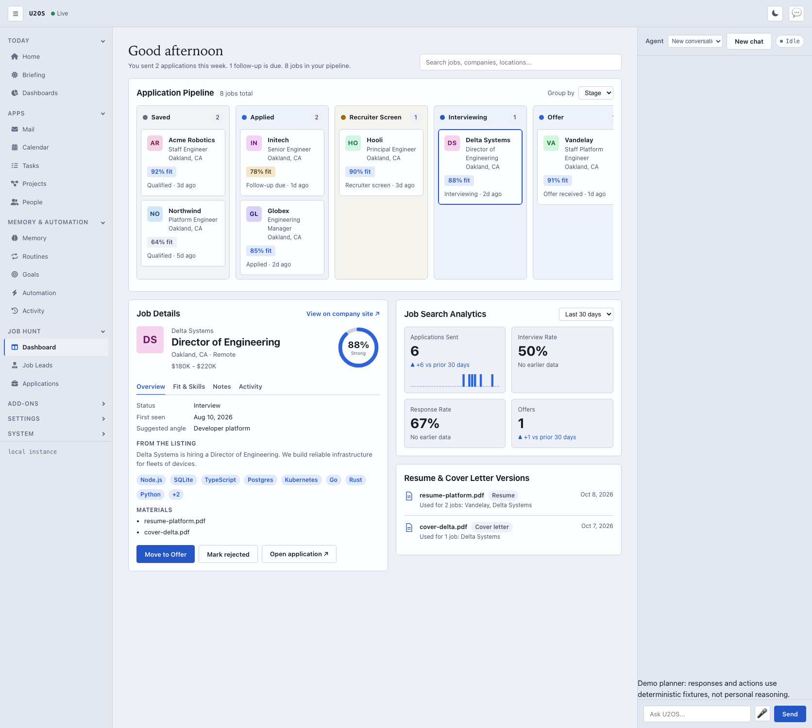

# Job hunting on your behalf

U2OS can search job boards and apply for you, unattended, within the limits you set. It is built from the parts every U2OS extension uses ([ADR 0009](adr/0009-extension-model-mcp-tools-vault-skills-routines.md)):

- a **routine** that says when to run and what to do (`routines/job-hunter.md`)
- a **skill** that says how you judge postings and how to answer for you (`skills/job-hunting.md`)
- the **job-hunt MCP server** (`mcp/jobs/`), which searches boards and fills in applications in a real, headless Chromium
- your **policy**, which decides whether an application needs your approval

## What it can and cannot do

It searches the public job boards of the companies you list, on **Greenhouse** and **Lever**, two of the most common applicant-tracking systems. It applies on the boards' own hosted application forms.

It does not use LinkedIn, Indeed or other sites whose terms prohibit automated applications or that require logging in. It never tries to solve or evade a CAPTCHA: when one appears, the application is handed to you.

## Setup

1. **Browser.** In the U2OS folder, run `npm install` and `npx playwright install chromium`. To use a Chromium you already have, set `JOBS_BROWSER_PATH` under the server's `env:` in `mcp.yaml`.
2. **Copy the example** from [`examples/vault`](../examples/vault/README.md) into your vault:
   - `mcp.yaml`
   - `policies.yaml` (or merge its `jobs:` section into yours)
   - `routines/job-hunter.md`
   - `skills/job-hunting.md`
   - `job-hunt/profile.md`
3. **Your preferences** go in `me.md`: target roles, minimum salary, locations and industries to avoid. The skill uses only what you state there.
4. **Your applicant profile** is `job-hunt/profile.md`, and everything in it may be sent to employers you apply to:
   - name, email, phone, location, current company and links
   - `resume:` a file next to the profile, such as `resume.pdf`
   - `boards:` the companies to search, such as `greenhouse:acme` for `job-boards.greenhouse.io/acme` and `lever:globex` for `jobs.lever.co/globex`
   - `answers:` your standard answers, matched by words in a question (`authorized to work: "Yes"`)
   - `max_applications_per_day:` default 5
   - `submit:` `false` fills forms without submitting them
   - the body: a default cover letter
5. **A model.** The routine needs a configured planning model; the built-in demo planner does not understand it.
6. Restart U2OS (or `POST /api/vault/mcp/restart`), check `GET /api/vault` shows the `jobs` server running, and set `enabled: true` in the routine.

Start with `submit: false`. Each run then fills real forms and saves screenshots in `job-hunt/applications/` without sending anything. When the forms look right, set `submit: true`.

## How a run goes

1. The routine searches your boards (`jobs.search_jobs`). Jobs you already applied to or skipped are left out. Greenhouse results include each application's questions.
2. The planner scores each posting with your skill. It proposes `jobs.apply` for strong matches, with answers and a short cover letter, and `jobs.skip_job` for the rest.
3. `jobs.apply` requires your approval unless your policy says otherwise. Approve it in the U2OS approvals view; the application is submitted then.
4. The server opens the form and fills your identity and resume from your profile. It fills the answers, submits, and waits for the board's confirmation.
5. You get one notification summarising the run.

To let U2OS apply without asking, set this in your vault `policies.yaml`:

```yaml
jobs:
  apply: autonomous
```

The daily limit and the ledger still apply.

## The ledger: `job-hunt/applications/`

The **Applications** view in the app lists the ledger with filters by status. It also lists what the autopilot recorded in the hunt store as actually sent: application emails (status *Emailed*, with the recipient, subject and attachments) and form applications that were submitted or unconfirmed. A ledger file for the same job takes precedence, and prepared or blocked applications are not listed. It shows what was sent (answers and cover letter), the questions waiting for your answers, and the form and result screenshots.

Every attempt is a Markdown file in your vault. It records the company, title, form address, status, the answers given, the cover letter and screenshots. It is your record of what was sent in your name, and it is what makes applying exactly-once.

| Status | Meaning | Applied again? |
|---|---|---|
| `applied` | Submitted and confirmed by the board | Never |
| `unconfirmed` | Submitted, but no confirmation appeared | Never; check it yourself |
| `needs_owner` | A CAPTCHA or challenge appeared | Never; finish it yourself |
| `needs_answers` | Required questions were unanswered; nothing was sent | Yes, once answered |
| `dry_run` | Filled but not submitted (`submit: false`) | Yes |
| `failed` | The board rejected the form; nothing was sent | Yes |
| `skipped` | You (or the routine) passed on it | Never |

To re-open a job, edit its status or delete its file.

## The Overview

`#/job-hunt` opens the **Overview** ([#629](https://github.com/chrisrobison/u2/issues/629), part of #626). It answers "what needs me, and how is the search going?" and keeps the pipeline board below it, so nothing was removed. Every number comes from one call, `GET /api/job-hunt/overview` (owner only, no parameters). The code is `mcp/jobs/hunt/overview.js` (view model) and `public/components/job-hunt/u2-job-overview.js` with `jh-overview-parts.js` and `jh-overview-model.js` (page).

- **Summary bar**: jobs discovered (every job; "+N this week" is jobs first seen in the last 7 days), strong matches, need your attention, applications submitted, employer responses and interviewing. Each card links to the matching Opportunities table (see below), so the table total equals the number on the card. A value the server cannot give is shown as "—", never as zero.
- **Autopilot**: *mode* (Paused, Dry run, Live, from `autopilot.yaml`) is shown apart from *status* (Idle, Running cycle, Degraded when the last cycle reported errors, Blocked when the settings file is invalid), with the last cycle time and a link to the existing autopilot controls on Job Leads. Switching mode stays there; the Overview changes nothing.
- **Application Pipeline**: Discovered, Qualified, Preparing, Needs Input, Submitted, Responded, Interviewing, Offer. Clicking a stage opens the Opportunities table filtered to that stage; its total equals the stage count (Needs Input opens the Needs Input tab).
- **Needs Your Attention**: one row per job (company, role, why, fit score, age or interview deadline) with a **Review** button that opens the job page; for an unanswered application question it opens that question (`#/job-hunt/jobs/<id>?question=<answer key>`, which scrolls to and focuses its input in the answers form).
- **Recent Activity**: the newest meaningful events, each linking to its job. "Application ledger" opens `#/applications`. There is no cross-job event history page, so the per-job history on the job page is the full history.
- **Pipeline board and details**: the previous dashboard, unchanged, below the Overview.

### Status to stage

A job is counted once, in the stage its **current** status belongs to. The stages are therefore not an overlapping funnel: they add up to the jobs on the pipeline, and a job that was submitted and is now interviewing appears only under Interviewing. The one exception is **Needs Input**, which is a flag, not a state: it counts the jobs in the attention queue, whatever stage they are in, and overlaps the other stages. The function is `overviewStageOf()` and every one of the 19 `JOB_STATUSES` is covered by a test.

| Stage | Statuses |
|---|---|
| Discovered | `discovered`, `scored`, `researching` |
| Qualified | `qualified` |
| Preparing | `materials_generated`, `applying`, `needs_input` |
| Needs Input (flag) | none: jobs in the attention queue |
| Submitted | `applied`, `contacted`, `followup_due` |
| Responded | `screening` |
| Interviewing | `interview` |
| Offer | `offer` |
| on no stage | `rejected`, `withdrawn`, `closed`, `skipped`, `error`, `uncertain` |

`rejected` is a response but ends the job, so it is not a stage; `uncertain` may or may not have been sent, so it is not counted as submitted and shows under Needs Your Attention. Both summary cards for *applications submitted* and *employer responses* count jobs **ever** sent or answered (from `application_events`, as in the analytics below), so they stay accurate after a job moves on; their sub-lines count the last 7 days.

**Strong match** means a latest score of at least **80**: the line where `scoreLabel()` (`jobs/scorer.js`) starts calling a score "strong", and the number in the Job Leads "Strong (80+)" filter. It is not the autonomous threshold (`minimum_score`, default 82), which only decides what the autopilot may act on.

### Needs Your Attention

Built from `jobAttention()` (`attention.js`) for jobs waiting on input, unconfirmed, with a stuck application attempt or a rejecting review, one item per job showing its most severe reason. The queue is sorted by **urgency** (a job with an interview in the next 7 days first; this is the only deadline U2OS stores), then **opportunity value** (the fit score; unscored last), then **blocking severity** (3: a possibly sent application nobody has confirmed, 2: U2OS cannot go on and you must act yourself or change settings, 1: you can unblock it with an answer), then the item waiting longest. The payload carries the top 20 and the full `count`. `question` (`{ key, label }`) is set only for unanswered application questions. Other reasons, such as a CAPTCHA, link to the job page, which shows the reason.

### Links into the Opportunities table and Job Leads

The Overview's cards and stages open `#/job-hunt/opportunities` with a query that reproduces the number: *Jobs discovered* the whole table, *Strong matches* `?min_score=80`, *Need your attention* `?filter=needs_input`, *Submitted*, *Responded* and *Interviewing* an explicit `?statuses=` list, and each stage `?stage=<id>`. Two caveats. *Applications submitted* and *Employer responses* are event-derived (jobs ever sent or answered), while the table can only filter on a job's current status, so a job that has since been withdrawn or closed counts on the card but not in the table. Everything else matches exactly (a test compares them on seeded data).

Job Leads still reads `#/job-hunt/leads?filter=<ready|needs_input|contacted|strong|all>` and `?statuses=a,b,c` (keep only jobs in those statuses; shown with a "Show all" button), so old links and bookmarks keep working. Job Leads lists the 150 best jobs scored 60 or more plus every job that needs you, so it can show fewer jobs than the Overview counts; the Opportunities table has no such limit.

### Refresh

The server publishes no `jobs.*` events (the only `jobs.` names are MCP tool names; the bus carries `agent.action.*` for approvals and sends). The Overview therefore refreshes on `agent.action.*` events (debounced) and polls every 30 seconds. Responses that arrive out of order are ignored, and a failed refresh keeps the last data under a "Showing the last data we loaded" notice with a Refresh button.

## Opportunities

`#/job-hunt/opportunities` ([#631](https://github.com/chrisrobison/u2/issues/631), part of #626) is a compact, searchable table of every job in the store. The server does the work: `GET /api/job-hunt/opportunities` (owner only, additive; `/jobs` is unchanged) filters, searches, sorts and pages in SQL, so the browser only ever holds one page. The code is `mcp/jobs/hunt/opportunities.js` (query), `public/components/job-hunt/u2-job-opportunities.js` (page) with `jh-opportunities-parts.js` and `jh-opportunities-model.js`.

**Columns.** Select checkbox, company, role (a link to the job page), location (stored locations, plus "Remote" when the listing says so), compensation (the listing's own text, for example `$180K - $220K`), fit score, status, posted date and the same per-listing action menu as Job Leads. A value U2OS does not have is shown as "—" and is never made up: a job with no score shows "—" (no "0"), a job whose source gave no posted date shows "—". *Fit score* is the job's latest overall score as stored; there is no breakdown column. *Posted* is the latest `posted_at` of any source that saw the job (Hacker News and ATS sources record one; some do not).

**Quick filters (tabs), each with a count.** The counts apply the current search, fit floor, remote switch and stage/status scope but not the tab itself, so the selected tab's count always equals the table total.

| Tab | Jobs |
| --- | --- |
| All | every job |
| Needs Input | the same set as the Overview's Needs Your Attention queue (`attentionItems()` in `overview.js`, which `buildAttention()` also uses): waiting on an answer, an unconfirmed or uncertain application, a rejecting review |
| Ready to Apply | Job Leads' "Ready to send" (a prepared `email.json` draft with nothing left to ask you and no application email in flight), kept to jobs still before submission (stages Discovered, Qualified, Preparing) and not waiting on you |
| Applied | the Overview's Submitted stage: `applied`, `contacted`, `followup_due` |
| Responded | the employer has answered: the Responded, Interviewing and Offer stages (`screening`, `interview`, `offer`) |
| Archived | left the pipeline on purpose: `rejected`, `withdrawn`, `closed`, `skipped` (`error` and `uncertain` appear under All; `uncertain` is also in Needs Input) |

Other query parameters: `stage=<discovered|qualified|preparing|needs_input|submitted|responded|interviewing|offer>` (the Overview stage mapping, `overviewStageOf()`), `statuses=a,b` (current status in the list), `min_score=0-100` (latest score at least this; unscored jobs are excluded), `remote=1`, `q=<search>`, `sort=<fit|company|role|status|posted|seen>` with `dir=asc|desc` (fit, posted and seen default to newest/best first, the rest A-Z; status sorts alphabetically by its name), `page` (from 1) and `limit` (default 25, at most 100). Jobs with no value for the sort key go last in either direction and ties break by job id, so pages never repeat or skip a job. An unknown value is `400`; numbers are clamped.

**Search** matches every word (AND) as a case-insensitive substring of the company, the role, any stored location or any stored skill/technology. It does not search the posting text, salary, contact details or notes: those columns are not indexed and are not what a table row is about. `%`, `_` and `\` are literal characters (LIKE wildcards are escaped) and all values are bound parameters. At several thousand jobs a search is a scan of the jobs table, which `tests/job-hunt-opportunities.test.js` measures; no new index was added, because no existing index could serve a substring match and the schema is left unchanged for existing installs.

**Response.** `{ items, total, page, limit, counts, query, strongMatchScore }`. `items` carry `id, company, role, locations, remote, compensation, skills, status, stage, needsInput, fit, fitLabel, postedAt, firstSeenAt`, with `null`/`[]` for anything missing; they do not include posting text or contact data. A page is at most 100 rows.

**Status labels** (friendly text and tone for the real statuses): discovered *Discovered*, scored *Scored*, researching *Researching*, qualified *Qualified*, materials_generated *Ready to apply*, applying *Applying*, needs_input *Needs input*, applied *Applied*, contacted *Emailed*, followup_due *Follow-up due*, screening *Recruiter screen*, interview *Interviewing*, offer *Offer*, rejected *Rejected*, withdrawn *Withdrawn*, closed *Closed*, skipped *Skipped*, error *Error*, uncertain *Outcome unknown*. A job in the Needs Input set whose status does not itself say so shows *Needs input*.

**In the page.** The tab, sort, search, fit floor, remote switch, stage/status scope and page number live in the URL hash (`?filter=…&sort=…&dir=…&q=…&page=…`), so a view can be bookmarked and the back button works (search replaces rather than adds history entries). Search is debounced; an answer that arrives after a newer request is ignored; loading, empty and error states use `jh-state`, and a failed refresh keeps the last rows.

**Keyboard and selection.** The table is an ARIA grid with one tab stop (roving tabindex over rows): Up/Down/Home/End move between rows, Space toggles the row's checkbox, Enter selects the row and opens the [detail panel](#the-job-detail-panel) beside the table. Double-click and the role link open the full job page (`#/job-hunt/jobs/<id>`). Clicking elsewhere on a row selects it too: it is marked as the current row (kept across refreshes, paging and, for the session, reloads) and a bubbling `jh-opportunity-select` event (`detail: { jobId, job }`) fires. The header checkbox selects every row on the page. Selection (the checkboxes) is cleared when the tab, search or filters change, and kept when only the sort or page changes.

**Bulk actions.** Only *Reject selected*, which asks for confirmation and then calls the existing `POST /api/job-hunt/jobs/<id>/status` with `rejected` once per job (the call a row's Reject uses, so the server's rules decide: a job that is at `offer`, say, is refused and stays selected with the reason shown). No bulk endpoint was added and there is no bulk "skip": no existing endpoint marks a job skipped.

## The job detail panel

`#/job-hunt/opportunities` is a [`<jh-workspace>`](#ui-primitives): the table is the main region and the selected job's panel the detail region ([#634](https://github.com/chrisrobison/u2/issues/634), part of #626). Choosing a row (click or Enter) opens it beside the table without leaving the page. Below 900px it is a drawer over the table; Escape or the Close button closes it. The code is `u2-job-detail-panel.js` (the element), `jh-detail-parts.js` (the tabs), `jh-detail-model.js` (URL, primary action and Match Analysis classification as pure functions) and `u2-job-notes.js` (the Notes tab). The full page `#/job-hunt/jobs/<id>` is unchanged and linked from the panel ("Open full page").

**URL and focus.** The selected job is the `job` parameter of the hash, beside the table state: `#/job-hunt/opportunities?filter=ready&sort=company&job=job_0123456789abcdef`. It survives a reload and can be shared; a value that is not a job id is ignored. Each selection is a history entry, so Back steps back through them and finally closes the panel; closing clears `job` and keeps every other parameter. Opening moves focus to the panel heading (a deep link on load does not take focus); closing returns it to the job's row. The selected row stays marked.

**Header.** Company, role, fit score, application status label, location (with Remote), compensation, the latest posted date of any source and a link to the original posting. Only `http(s)` links are ever shown; a value U2OS does not have is left out, never invented ("Not scored" for an unscored job).

**Primary action.** One button, chosen from the job's real state, the rest in **More** (each item shows why it is unavailable, with the same rules as the job page and the row menu):

| State | Primary action |
| --- | --- |
| a settled job (applied, rejected, offer ...) | none (only the posting link) |
| unanswered form questions | *Answer questions (n)*: the existing dialog |
| application planned and ready | *Review and approve*: opens the Application tab on the approval box and does nothing else |
| last attempt failed, or the job is in error | *Retry planning* (`POST .../plan`) |
| nothing prepared yet | *Prepare application* (`POST .../plan`, which sends nothing) |
| otherwise | *Open posting* (a link) |

*Mark not interested* is the existing **Reject** (`POST /api/job-hunt/jobs/:id/status` with `rejected`, after the same confirmation): the status endpoint has no "skipped" target, so the two are one action. Every other action is one of the shared tasks of `u2-job-actions.js` (prefill, plan, email, draft, mark applied). The panel adds **no endpoint and no way to submit or send**: an application is submitted only by the shared *Ready to submit* box, which still needs *Approve and submit...* and then *Yes, submit this application* and sends `planHash` with `confirm: true` to `POST .../approve-and-submit` (see [approve and submit](#the-job-details-page)). `tests/job-hunt-detail-panel-ui.test.js` checks that the review action makes no request, that the final call needs both clicks, and that every request the panel makes is one of the existing job-hunt endpoints.

**Tabs** (an ARIA tablist; Left/Right/Home/End move between them):

- *Overview*: summary (score, approach, technologies), *Why this is a strong match* (the scorer's stored reasons; "Why it fits" under a score of 80), *Gaps to address* (confirmed gaps and the scorer's concerns), *Uncertainties* (the unverified items that are missing information) and *Blockers* (the same "Needs you" reasons as the job page).
- *Match Analysis*: see below.
- *Application*: status and outcome, the unanswered questions (with the Answer questions button), the approval box, the latest review, materials, the email draft and sent emails, the planned answers and the history from `application_events` (newest first, at most 25).
- *Company*: the company site, the sources that saw the job (with links), the job's contacts and the research section.
- *Notes*: see [Job notes](#job-notes).

**Match Analysis.** The panel states what the stored data supports, in three groups, and shows the overall score, the scorer's stored confidence (only when stored), the model and the date. It shows no per-requirement or per-skill number and no bar.

| Group | What goes in it |
| --- | --- |
| *Verified match* | something backed by a stored source: the location and compensation rules (the posting compared with your preferences), a project of yours the scorer matched (with its link), and a passing review check that your facts support the form answers or the resume and letter (with the review's date) |
| *Unverified or insufficient evidence* | (each judged dimension and concern has a question, see [Evidence resolution](#evidence-resolution)) the scorer's model-judged dimensions (experience, seniority, technical, company, interest: a judgement with no source stored), concerns nobody confirmed, a failed "supported by your facts" check, form questions with no answer on file, and anything the posting leaves out ("Location not stated") |
| *Confirmed gap* | what a rule proves (relocation required, pay below your minimum) and what you answered No to, labelled **Stated by you** |

Missing evidence is never reported as a missing skill: a failed facts check says "your facts do not cover this yet", and a posting that omits something is not a gap. A rules-only score (no model) says so.

**Limitations (the data model cannot support more yet).** The posting is not split into individual requirements, so the analysis lists the scorer's reasons and the review checks rather than a line-by-line comparison. A model-judged match stays *unverified* until you state evidence for it ([Evidence resolution](#evidence-resolution)). U2OS keeps no research about a company, so the Company tab's research section is an honest empty state (research run from Goals is not attached to jobs). The Overview tab does not use the scorer's `narrative` field: it is a strategy id, not prose.

**States.** Loading, a failed load (with *Try again*), a job that no longer exists ("This job no longer exists", nothing to retry) and an unexpected payload each have their own message. A response that arrives after the owner chose another job is ignored. The panel loads the job itself, so it keeps working when the table's page no longer lists that row.

## Evidence resolution

Phase 5 of the redesign ([#636](https://github.com/chrisrobison/u2/issues/636), part of #626). In the Match Analysis tab, each *Unverified* item that the scorer judged has a question under it: **Can you back this up?** The owner answers **Yes, I can back this up**, **No, this is a gap** or **Partly**, with an optional detail (at most 1,000 characters), and presses *Save and rescore*. The code is `mcp/jobs/hunt/evidence.js` (questions, storage, rescoring), `jh-evidence-form.js` (the form) and two routes.

**Which items have a question.** Only what a model judged or raised: the dimensions *experience*, *seniority*, *technical*, *company* and *interest*, and concerns (the scorer's and the latest review's, except the rules-only caveat and the concerns that the location and pay rules produced). Rule results, projects, failed "supported by your facts" checks and unanswered form questions (use *Answer questions*) have none. The questions are derived on the server from the job's stored score and review and arrive in `GET /api/job-hunt/jobs/:id` as `evidence.questions` (`key`, `kind`, `statement`, `prompt`, `source`). A client cannot invent a question or change its wording: a key that is not one of the job's current questions is refused (`400`). Keys are stable: `dim:<dimension>`, or `concern:` and 12 hex digits of the SHA-256 of the concern's text (a concern the scorer words differently after a rescore is a new question; the earlier answer stays on file but is no longer shown).

**What a saved answer does.**

| Answer | Match Analysis | `facts.md` |
| --- | --- | --- |
| Yes | moves to *Verified match*, source **Stated by you** | a marked line is added, so the claim guard and the materials generator may use it |
| Partly | stays *Unverified*, with your words shown | a marked line is added ("can partly back up") |
| No | moves to *Confirmed gap*, "A gap because you said so" | nothing: a gap is not a claim anything may make |

Owner-stated evidence is never presented as system-verified: it carries the source **Stated by you**, the note "Your own statement. U2OS has not checked it against anything else.", and a provenance line ("Yes, stated by you on Oct 30, 2026. Recorded in job-hunt/evidence/<job-id>.md as dim:technical."). No dimension's points and no per-skill number is changed or invented by an answer; only the scorer's rescore can change the score.

**Where it is stored.** `job-hunt/evidence/<job-id>.md`, one file per job, written with the vault's atomic editor (see [vault](vault.md)):

```markdown
---
job: job_0123456789abcdef
company: Acme
role: Staff Engineer
updated: 2026-10-30T12:00:00.000Z
answers:
  - key: dim:technical
    answer: yes
    detail: Four years of Go services
    label: "Technical: Partial overlap with the stack"
    source: owner
    job: job_0123456789abcdef
    at: 2026-10-30T12:00:00.000Z
---
# Evidence you stated for Acme - Staff Engineer
- 2026-10-30 Yes: Technical: Partial overlap with the stack (Four years of Go services)
```

Every entry carries its provenance: `source: owner`, the job id, the question key, the question's text at the time and the timestamp. The front matter is the record (the body is regenerated); entries for another job or with an unknown key, answer or source are ignored when read, and a damaged file is reported on the panel without hiding the rest of the job. Yes and Partly answers are also added to `job-hunt/facts.md` under `## Owner-stated evidence`, one line each, starting with `<!-- u2-evidence <job id> <key> -->`; changing the answer replaces its line and a No removes it, and your own text in the file is never touched. (This is the existing store of owner-approved facts; `answers.yaml` holds form-question answers and is not used here, and nothing is written to memory.) The paths are derived only from a validated job id and a fixed key; a link (symlink) as `job-hunt`, `job-hunt/evidence`, an evidence file or `facts.md` is refused (`409`); files are written `0600` through a temporary file and a rename, and refused if they changed meanwhile; the detail must be plain text (no control characters) and a job holds at most 100 answers. Saving the same answer again changes nothing, keeps the first timestamp and repairs a missing `facts.md` line. Answer text is never logged.

**Rescoring.** After a changed answer the job is scored again by the existing scorer (`scoreJob`, then `store.saveScore`, exactly as `job score --rescore` does); no new algorithm. The one difference is the model's input: the candidate digest gets an `OWNER-STATED EVIDENCE FOR THIS JOB` block with each statement and your answer (Yes, Partly, or No with "the candidate says this is a real gap"), and nothing is added when you stated nothing. The scorer's weights, clamps and thresholds are unchanged, so the model cannot raise a dimension past its maximum on your say-so alone. The response and the panel show the previous and the new fit and scorer confidence ("Rescored. Fit 74% → 81%; scorer confidence 62% → 85%."), with "—" for anything not stored.

A rescore that cannot run never loses the answer and never replaces a model score with a rules-only estimate:

| Situation | Result |
| --- | --- |
| no model available | `pending`: "Saved, but not rescored yet: No model is available right now. Fit stays 74%..." |
| the model failed or fell back to rules (which ignore your answer) | `failed`, the old score is kept |
| no resume, or any error | `failed` with the message |
| the job is applying, applied, contacted, in follow-up, screening, interview, offer, rejected, withdrawn, closed, skipped or uncertain | `skipped`: the score is left as it was |

The panel states this in an alert with a **Retry rescore** button. The score is known to be out of date whenever the newest answer is newer than the score (`evidence.rescorePending`), so the alert and the button come back after a reload. `job score` run in bulk does not include your statements; only the rescore here does.

**API** (owner only, CSRF-protected like the other writes; each holds the job's lock, so another action in progress is a `409`):

- `POST /api/job-hunt/jobs/:id/evidence` with `{ key, answer: 'yes' | 'no' | 'partly', detail? }` returns `{ saved, changed, rescore, job }`. `rescore` is `{ status: 'done' | 'pending' | 'failed' | 'skipped', reason?, previous, current }`, or `null` when the answer was identical to the one on file. Errors: `400` (invalid id, key not a current question, bad answer or detail), `404`, `413` (detail over the limit), `409`, `422` (damaged evidence file).
- `POST /api/job-hunt/jobs/:id/rescore` rescores without a new answer (the retry) and returns `{ rescore, job }`.
- `GET /api/job-hunt/jobs/:id` carries `evidence: { questions, answers, lastAnsweredAt, rescorePending, error? }`.

**Safety.** Neither route approves, plans, sends or submits anything and neither changes a job's status, application, review or email. The autonomous policy is unchanged: a higher score after rescoring still has to pass the same checks, review and two-step approval as any other job. `tests/job-hunt-evidence.test.js` checks that the only new routes are these two, that no application, email, review or status changed, and that `approve-and-submit` still needs `confirm: true` and a plan hash.

## Job notes

The Notes tab keeps the owner's notes for a job as one Markdown file in the [vault](vault.md): `job-hunt/notes/<job-id>.md`.

```markdown
---
job: job_0123456789abcdef
company: Acme
role: Staff Engineer
updated: 2026-10-29T12:00:00.000Z
---
Anything you write, as Markdown. Edit it here or in any text editor.
```

`GET /api/job-hunt/jobs/:id/notes` returns `{ jobId, path, exists, body, revision, updatedAt, maxBytes }` and `PUT` with `{ body, revision }` saves (owner only, with the usual CSRF check). The code is `mcp/jobs/hunt/notes.js`.

- **Path-safe.** The file name comes only from a job id that matches `job_` and 16 lowercase hex digits and that exists in the store; the id never reaches the file system otherwise. A link (symlink) as `job-hunt`, `job-hunt/notes` or the note itself is refused (`409`).
- **Size.** At most 64 KB of text (`413` over that); a NUL character is refused.
- **Revision and conflicts.** `revision` is the SHA-256 of the file's exact text (`null` when there is no file). `PUT` must send the revision it was based on; any other value is `409` with `code: "CONFLICT"` and the current note, and nothing is written. The UI keeps your text, shows an alert, and offers *Reload from file* or *Keep editing*. A `PUT` without `revision` is `400`. The file is also re-checked just before the atomic rename, so a change made during the write is refused too.
- **Atomic write, nothing extra.** The file is written to a temporary name and renamed over the note (the vault's `editVaultFile`, mode `0600`); an unchanged body does not touch the file. Only `job`, `company`, `role` and `updated` are set; every other front matter key and comment you added in an editor is kept. A note that was never edited creates no file and no folder (saving an empty note is a no-op); clearing a saved note keeps the file with an empty body.
- **External edits converge.** The file is read fresh on every `GET`, and the tab re-reads it each time it opens (unless you have unsaved text). A file with broken front matter is reported (`422`) and left alone.
- **Unsaved text.** Moving to another job saves unsaved text first. If that save conflicts, the text is kept in `sessionStorage` and offered back (*Restore it* / *Discard it*) the next time that job's notes open in the same browser tab.
- **Text, never HTML.** The body is shown in a plain `<textarea>` and stored as text; Markdown is not rendered.
- **Vault conventions.** The indexer reads only `people/`, `projects/` and `commitments/`, so notes are not indexed as memory facts and no job-hunt code reads them back into a prompt. The journal never holds note text, so a save is not journaled; `job-hunt/notes/` is not one of the watched configuration files. Back it up and sync it like the rest of the vault ([backups](vault.md#backups)).

Tests: `tests/job-hunt-notes.test.js` (module and API: path traversal, symlinks, oversize, conflicts, round trip with an externally edited file), `tests/job-hunt-detail-panel-ui.test.js` (components) and `tests/e2e/job-hunt-detail-panel.spec.js`.

## The dashboard



The pipeline board below the Overview (it used to be all of `#/job-hunt`); the ranked list is **Job Leads** at `#/job-hunt/leads`, and the ledger stays at `#/applications`.

- **Application Pipeline**: six columns (Saved, Applied, Recruiter Screen, Interviewing, Offer, Rejected) of job cards with fit, location and the last status change. Search filters the cards as you type; *Group by* switches between stage and fit band. Selecting a card fills Job Details.
- **Job Details**: fit ring, salary and location, tabs for Overview, Fit & Skills, Notes and Activity (the job's recorded status history and emails), and the owner's moves: *Move to Recruiter Screen*, *Move to Offer*, *Mark rejected* (the server decides which moves are allowed) and a link to the application. Per-job notes are not stored yet, so the Notes tab says so.
- **Job Search Analytics**: applications sent, interview rate, response rate and offers over 7, 30 or 90 days, compared with the window before, with a sparkline of applications sent per day.
- **Resume & Cover Letter Versions**: each distinct file generated for jobs and the jobs that used it.
- **Upcoming Interviews**: the next 30 days of interviews as dated rows (month and day, company, role and round, time range, format and link or location). Add one with *Add interview* in Job Details.
- **Tasks & Follow-ups**: a checklist of open tasks (soonest due first, undated last) and those completed in the last week, with *N due this week*. Overdue and due-today labels carry state tones. Tick a task to complete it (untick to undo), *Snooze* pushes it a day, and the company name selects its job. Add your own with *Add task* in Job Details.
- **Networking & Contacts**: people per job, most recently contacted first, each with a monogram, name, title and company, a role chip (Recruiter, Referral, Hiring Manager, or Contact) and *Last contact 3d ago*. The envelope opens a `mailto:` draft in your own mail client; *Contacted* stamps today, *Edit* changes name, role and title, *Remove* deletes. With no contacts the panel says so and *Add contact* is still there. There is no LinkedIn icon: U2OS makes no external lookups.

The page reads `GET /api/job-hunt/dashboard?days=30` and records moves with `POST /api/job-hunt/jobs/:id/status`. It refreshes on `agent.action.*` events (no `jobs.*` event is published; see Refresh above). Interview and task changes use the endpoints under *Interviews and tasks* below, and contact changes those under *Networking contacts*. The code is in `public/components/job-hunt/` and depends only on `services/api.js`.

## Safety and privacy

- **Identity comes from your files, not the model.** The model only picks jobs and writes answers and cover letters. It cannot change your name, email, phone, links or resume.
- **Demographic questions** (gender, race, pronouns, veteran status, disability, sexual orientation, Hispanic/Latino, transgender) are only ever answered from the `demographics:` block of your own `answers.yaml`, never by the model, and only when the form offers a matching option (otherwise the form's *decline* option is chosen). Any other self-identification question is declined unless you answer that exact question under `custom:`.

  ```yaml
  demographics:
    gender: Male
    race: White
    pronouns: He/him
    veteran: false
    disability: false
    sexual_orientation: Straight
    hispanic: false
    transgender: false
  ```
- **The model never supplies a web address.** Form addresses are built from board and job ids, so the browser only goes to Greenhouse and Lever application pages.
- **Unanswerable questions stop the application** before anything is sent.
- **Submission is recorded before the click.** A crash can never cause a second application.
- **Server and board data stay local**, except what the forms send to the employer. Search results and application outcomes reach your planning model at the classification set in `mcp.yaml` (`personal` in the example), under your [data-processing policy](policies.md).

## Limits

- Only companies on Greenhouse or Lever, listed by you. Discovering new companies is up to you (or a future tool).
- Hosted forms vary. Unusual custom widgets may be reported as `needs_answers` or `failed`; the screenshots show why.
- Lever's application questions are discovered when the form is first opened. The first attempt at a Lever job therefore often returns `needs_answers`, and the next run answers them.

## Hacker News "Who is hiring?" discovery

The pipeline in [`job-hunt2.md`](job-hunt2.md) is built in phases on top of the same server and vault. Phase 1 discovers listings.

```bash
npm run u2 -- job discover hn                       # newest "Ask HN: Who is hiring?" thread
npm run u2 -- job discover hn --month "October 2026"
npm run u2 -- job discover hn --dry-run             # parse and report, store nothing
npm run u2 -- job status
```

The thread is found by searching for the title (never a fixed item id). Each top-level comment becomes one record per role, with the original text and author kept. The parser is deterministic and treats the text strictly as data: it extracts the company, roles, locations, remote, salary, equity, visa stance, technologies, contact emails and URLs, and nothing in a listing can trigger an action.

Records are stored in `job-hunt/state/hunt.sqlite` in your vault: `jobs`, `job_sources` (every sighting, with its raw text) and `application_events`. One opportunity seen through several sources (an HN comment, a Greenhouse posting, a careers page, next month's repost) is merged into one job, recognised by application URL, ATS job id, or normalised company and role. Re-running discovery never creates duplicates.

Code lives in `mcp/jobs/hunt/` (`sources/`, `jobs/`, `storage/`); the command is `server/jobhunt/cli.js`.

## Scoring jobs against you

```bash
npm run u2 -- job profile import "resume.json"    # JSON Resume; copied to job-hunt/resume.json
npm run u2 -- job github refresh                  # public repos, cached in job-hunt/state/github.json
npm run u2 -- job score [--limit 20] [--rescore] [--company foo] [--role staff] [--no-model]
npm run u2 -- job list [--min-score 80]
npm run u2 -- job show <job-id>
```

`job-hunt/preferences.yaml` (optional) sets `minimum_score` (the autonomous-application threshold, default 82), `locations`, `home.areas`, `minimum_salary`, `preferred_roles`, `avoid` and `interests`.

**Who decides what.** The model judges experience and domain match (transferable experience, not keyword counts), seniority fit, technical overlap, project overlap, company and stage, and personal interest. Code owns everything else: the weights (experience 25, seniority 20, technical 15, projects 15, location 10, company 5, compensation 5, interest 5), clamping every model number to its maximum, location and compensation from the structured facts, the total, the thresholds (90 exceptional, 80 strong, 70 plausible, 60 weak, below that skip) and the allowed narratives. A junior title caps seniority however the model scores it. Roles outside engineering are triaged without a model call. Each score stores its dimensions, confidence, reasons, concerns, recommended narrative (one of six: engineering leadership, staff/principal, developer platform, AI/agent systems, operational software, adtech/analytics), up to four relevant GitHub projects, and flags such as `relocation_required` and `salary_below_threshold` for the policy engine.

**Prefilter.** Scoring a few hundred listings with a model takes a while, so `job score` first computes the rule-based estimate and sends only jobs at or above `--prefilter` (default 55) to the model. Against jobs the model had already scored, 55 kept every one it rated 70 or higher while skipping about a quarter of the calls. A screened-out job keeps its rule score, is marked degraded (so it can never auto-qualify and `job materials` refuses it) and says why in its concerns; `job score --rescore --screened --prefilter 0` sends exactly those through the model later. `--prefilter 0` turns screening off.

**The model** is your configured U2OS connections in your order (for example Claude first, Codex as the backup). Only CLI connections can complete plain text today. If none answers, a rule-based estimate is used, labelled degraded and capped at 79, so it can never reach the autonomous threshold. The model receives a digest of your resume (no phone, email or references) and the listing, delimited and declared untrusted data; its answer must pass schema validation or it is rejected.

## Tailored materials

```bash
npm run u2 -- job materials <job-id> [--force] [--no-pdf] [--cover-letter | --no-cover-letter]
```

Writes `job-hunt/materials/<company>/<role>/` with `resume.json` (kept so it can be regenerated), `resume.txt`, `resume.pdf` (one to two pages, rendered by headless Chromium), a cover letter (`cover-letter.txt` and `.pdf`) when the job warrants one, and `email.json` (recipient, subject, text, attachments) when the listing names an address. Each file is recorded with its SHA-256 in the `artifacts` table and the job moves to `materials_generated`. Materials are reused unless `--force`. Jobs scored by rules (no model) are refused.

**What the model can and cannot change.** Name, contact details, titles, companies, dates, locations, education and the choice of which positions to show come from your canonical `resume.json`; the model picks emphasis and wording. Its text may only claim what your sources support: `resume.json`, `job-hunt/facts.md` (facts, bullets and `## Project: Name` sections you approve, for example lifted from résumés you already sent), and your public repositories. A claim guard checks every generated sentence: each number, link, email address, technology and proper noun must appear in those sources (or, for the summary, letter and email, in the listing itself). A violation is rejected and the model is asked again with the reason; it is never silently repaired. Letters must be 250-450 words, name the company and avoid stock openers; emails are 40-170 words and the system, not the model, writes the greeting, sign-off and links. `job-hunt/voice.md` holds samples of your own writing for tone.

**Approach (strategy)** is chosen from the listing's facts, not by the model: an email address gives `DIRECT_EMAIL`, an application link `FORM_APPLICATION`, both `FORM_AND_EMAIL`, neither `MANUAL_REQUIRED`, and a score below `minimum_score` `SKIP`. Nothing is sent or submitted by `job materials`.

## Sending application emails

```bash
npm run u2 -- job send <job-id> [--force]   # propose the email through the approval gate
npm run u2 -- job reconcile                 # after approving: mark jobs contacted
```

`job send` proposes the job's `email.json` as an `email.send` action (with the staged resume and cover letter attached, see [tools](tools.md#email-attachments)). It goes through the same gate as everything else, so your policy decides whether it needs approval; by default it waits in **Approvals** in the U2OS UI, where you see the recipient, subject, body and attachment names, and approve or reject. Like the other offline commands it needs the U2OS server stopped while it runs; the pending approval is in the database when the server restarts.

Refused, whatever else: the draft still needs your input (`needs_input`), the job is unscored or scored without a model, a send is already proposed, sent or uncertain, or the job is already contacted/applied. A score below `minimum_score` is refused unless you pass `--force` (your explicit decision to go below the threshold). Intent is recorded in the `emails` table under an idempotency key (candidate, company, role, job, action and recipient) before anything is proposed, so a crash cannot cause a second send; a proposal that failed before queueing, or one you rejected, can be proposed again. `job reconcile` reads the outcome of each approved action: executed sends mark the job `contacted` with a follow-up date (`follow_up_days`, default 5 days); a failure whose outcome is uncertain marks the job `uncertain` and blocks any further send until you check Sent mail.

## The Job hunt page and sending from the running server

**Job Leads** in the app (Job hunt, `#/job-hunt/leads`) lists scored jobs, best first: the score and why, concerns, the recommended narrative, the approach, the materials and the draft email (recipient, subject, body, attachment names). Filters: *Ready to send*, *Needs you* (the listing asked for something your facts do not cover), *Contacted*, *Strong (80+)* and *All scored*.

The buttons propose the email through the running server's own approval gate; nothing is sent until you approve it in **Approvals**:

| Button | Tool | Needs |
|---|---|---|
| Send with Mail | `apple_mail.send` | the Apple add-on enabled (macOS), see [the add-on](../addons/apple/README.md#sending-mail-with-attachments-apple_mail) |
| Send with Gmail | `email.send` | a connected Gmail (or SMTP) account |
| Save draft in Mail | `apple_mail.draft` | the Apple add-on; saves a draft for you to review, sends nothing |

A route whose tool is not available is disabled, and the API says why; there is never a silent fallback to a different route. The duplicate rules are the same whichever route you use (one application email per job and recipient), and a draft never marks a job contacted. A job scored below `minimum_score` shows *Send ... anyway*, which is your explicit choice.

Outcomes are reconciled as soon as an action completes, fails or is rejected, and again whenever the page loads, so approved sends move jobs to `contacted` (with a follow-up date) without stopping the server. The same is available over the owner API: `GET /api/job-hunt/jobs[/<id>]`, `POST /api/job-hunt/jobs/<id>/send` with `{ "via": "gmail" | "apple_mail" | "apple_mail_draft", "force": false }`, and `POST /api/job-hunt/reconcile`. `job send` and `job reconcile` on the command line remain for the Gmail route when the server is stopped.

**Sorting.** *Sort by* above the list orders every tab by Score (default), Newest (when it was first seen), Company, Role or Status; the arrow button reverses it. Jobs with no value for the key go last either way, ties keep best-score-first order, and the choice is remembered in this browser.

## The job details page

Click any job in Job Leads, the autopilot's *Needs you* and activity lists, the applications ledger, or *Open full page* in the dashboard's details panel to open `#/job-hunt/jobs/<job-id>`. The URL can be bookmarked and reloaded. The page shows everything U2OS has stored for the job: the posting text and links, the score and why, every application attempt (the planned answers, what was left unanswered, the outcome and its screenshots), every review (failed checks, blocking and minor concerns, notes), the materials and email, contacts, tasks, interviews and the history.

**Action bar.** At the top of the page, buttons act on the job. Each one is disabled, with the reason as its tooltip, when it cannot apply (no email address, no application link, no Apple add-on, an email already sent, the job already settled).

- **Open and Pre-fill** is the fastest way to apply by hand. It plans the form if it is not planned yet (as Apply Online does), then opens the application page in a visible browser window, fills in every planned answer and attaches the resume, and leaves the window open (`POST /api/job-hunt/jobs/:id/prefill`). **It never submits**: you read the filled form, fix anything, press the board's own submit button, then use *Mark Applied*. It needs no approval because nothing is sent; the plan stays approvable and the job's stage does not move. If a question is unanswered nothing is opened and you are pointed to Answer Questions; a CAPTCHA, login wall or field that could not be filled leaves the window open for you to finish by hand. It always uses a visible window, whatever `browser.headed` says.
- **Apply Online** writes the job's materials if they do not exist, reads the application form and plans every answer (`POST /api/job-hunt/jobs/:id/plan`). It submits nothing: when the plan is ready, the *Ready to submit* box below keeps its two-step approval. Unanswered questions point you to Answer Questions.
- **Apply via Email** writes the materials if needed, asks you to confirm, then proposes the send through the action gate (`POST /api/job-hunt/jobs/:id/email`, `mode: send`): Apple Mail when the add-on is on, otherwise Gmail. If your policy wants approval first, the result says it is waiting on the Approvals page. Your score threshold does not apply to a button you press; a duplicate send still does.
- **Prepare Email** does the same but saves the message in Apple Mail's Drafts folder (`mode: draft`). Nothing is sent.
- **Answer Questions** opens a modal with one input per question the form asked that U2OS could not answer. Answers are saved to `job-hunt/answers.yaml` and reused for every later application, then the form is planned again. Sensitive questions are listed but never answered for you.
- **Mark Applied** asks for confirmation, then records that you applied yourself (moves the job to *Applied*, so the autopilot skips it and the analytics count it). Nothing is sent. Not offered once a job is already applied or closed.
- **Reject** asks for confirmation, then moves the job to *Rejected* (also for leads that never reached the pipeline). Nothing is sent to the company.

Every outgoing email is Bcc'd to the address in `mailBcc` ([tools](tools.md#email-attachments)).


At the top, **Needs you** says in words what is waiting on you and what to do about it: unanswered required questions, a CAPTCHA or login wall, an application whose outcome is unknown, a form that showed no confirmation, or the review agent's objections. A job that is applied, contacted or otherwise settled shows nothing there (except an uncertain one). **Answering questions.** When the latest plan has unanswered questions, the Needs you box has a form with one input per question (a choice list with the form's own options for choice questions). *Save answers and re-plan* writes each answer under `custom:` in `job-hunt/answers.yaml`, keyed by the question's full label (your comments and other entries are left as they are, an entry for the same question is replaced, and the change goes in the journal with the question text only, never the answer), then reads the form again and plans it. Only questions that are unresolved in the job's latest plan can be answered, and the label always comes from the stored plan. An answer to the exact question also settles one U2OS never infers on its own (salary history, clearance, citizenship and similar); a short `custom:` fragment such as `country` still cannot answer one of those by accident. Plans made before this carry no choice lists, so re-plan once to get them.

**On every listing.** Each card in Job Leads and on the dashboard's pipeline board has two icon buttons and a **...** menu, so you can triage without opening each job: *Open and pre-fill the application*, *Reject* (asks for confirmation first), and the menu with Apply online, Apply via email, Prepare email draft, Answer questions, Mark applied, Open job page, Open posting in a new tab and Reject. They are the same actions as the action bar, with the same confirmations and the same reasons shown as tooltips on disabled items. On the board the buttons appear when you hover or focus a card (always on touch screens).

**Approve and submit.** When the latest application is planned and ready, a **Ready to submit** box shows every answer and file that will be sent and the form link. *Approve and submit…* asks again ("This sends your application to the company now, from a browser window on this computer. It cannot be undone.") and only *Yes, submit this application* sends it. This is the owner's own approval: it is recorded as a review (`model: owner`) bound to the exact content, an `owner_approved` event, and then the application goes through the same guarded submit as the autopilot, **live whatever the autopilot's mode** and in the browser window the settings choose (`browser.headed`). It overrides only the review agent's judgement; if the agent rejected, the box says what it objected to. The rules still apply and refuse with a reason: daily and per-company limits, duplicates, the blocklist, a closed job, an application that is uncertain or already sent. The plan hash shown must still match the stored plan, so a plan that changed since the page loaded is refused. The result (submitted, unconfirmed, failed) stays on the page, and an unconfirmed one is never sent again.

**From the dashboard.** A card on the pipeline whose application is planned and ready (and whose job is not already sent, closed or uncertain) has an **Approve** button. It sends nothing by itself: it fetches the job fresh and opens a dialog with the same Ready to submit box (the planned answers, the review agent's objection if any, then *Approve and submit…* and the explicit *Yes, submit this application*). The dialog cannot be closed while a submit is running, shows the result, and the board refreshes afterwards.

The rest of the page is read-only; stage moves stay where they are.

`POST /api/job-hunt/jobs/:id/answers` with `{ answers: [{ key, value }] }` saves answers and re-plans (it returns the refreshed job). `POST /api/job-hunt/jobs/:id/approve-and-submit` with `{ planHash, confirm: true }` records the owner's approval and submits (409 with a `code` when refused: `STALE_PLAN`, `NOT_READY`, `CHECKS_FAILED`, `IN_PROGRESS`). `GET /api/job-hunt/jobs/:id` carries all of this (`applications`, `reviews`, `contacts`, `tasks`, `interviews`, `attention`), and `GET /api/job-hunt/jobs/:id/screenshot?path=<file>` serves one attempt screenshot: a PNG inside `job-hunt/state/screens/<job-id>/`, a regular file, owner only.

## The dashboard API

(The Overview has its own endpoint, `GET /api/job-hunt/overview`, described above; this one feeds the board.)

`GET /api/job-hunt/dashboard[?days=30]` (owner only; `days` is a whole number from 1 to 365) returns the whole dashboard in one call. The code is `mcp/jobs/hunt/dashboard.js`; the route only calls it.

**Stages.** One function, `stageOf(status)`, maps a job status to a pipeline stage:

| Stage | Statuses |
|---|---|
| Saved | `qualified`, `materials_generated` |
| Applied | `applied`, `contacted`, `followup_due` |
| Recruiter Screen | `screening` |
| Interviewing | `interview` |
| Offer | `offer` |
| Rejected | `rejected` |

Every other status (`discovered`, `scored`, `uncertain`, `withdrawn`, ...) is not on the board. `screening` and `offer` are new statuses; status is free text in `hunt.sqlite`, so no migration is needed and existing rows are untouched. Each stage has its full `count` and up to 100 cards, newest first. A card is `{id, company, role, location, fit, status, statusLine, timestamp, companyUrl}`: `fit` is the latest score (or null), `timestamp` the job's last status change.

**Analytics** cover the window `[now - days, now)` and the equally long window before it, and are derived only from `application_events` rows of type `status`:

- *Sent*: a job is sent at its first status event to `applied` or `contacted`.
- *Applications sent*: jobs sent in the window.
- *Response*: a job that, after being sent, has any status event to `screening`, `interview`, `offer` or `rejected`. *Response rate* = of the jobs sent in the window, the share that has responded (so far).
- *Interview rate*: the same cohort, the share that reached `screening`, `interview` or `offer` after being sent. A rejection alone is a response but not an interview.
- *Offers*: jobs whose first status event to `offer` falls in the window.

Rates are cohort based, so they are always between 0 and 1 and recent applications count as not yet answered. A rate with no jobs sent is `null` (never NaN), and so is its `change`. Each metric has `value`, `previous` and `change` (value minus previous, as a fraction for rates); rates add `numerator`, `denominator`, `previousNumerator` and `previousDenominator`. `sentByDay` is the window's sends per UTC day.

**Resume versions** are the distinct `resume_pdf` and `cover_letter_pdf` artifacts (by content hash), newest first, each with the latest job that used it (`job`) and every job that did (`usedBy`).

**Moving a job.** `POST /api/job-hunt/jobs/<id>/status` with `{ "status": "screening" | "offer" | "rejected" }` records the company's answer as a status event (`detail.by = "owner"`). Allowed: `screening` from `applied`, `contacted`, `followup_due`, `uncertain`; `offer` from those plus `screening` and `interview`; `rejected` from any board status, `uncertain` or `needs_input`. Anything else is `409`, an unknown target `400`, an unknown job `404`. Repeating a move changes nothing and answers `changed: false`.

## Interviews and tasks

Both live in the hunt store (`hunt.sqlite`, schema v7, additive: tables `interviews` and `job_tasks`) and are deliberately **not** mirrored into the core calendar or tasks tables, so the job hunt stays extractable. The logic is `mcp/jobs/hunt/schedule.js`; routes only call it. All endpoints are owner only.

| Endpoint | Body | Result |
|---|---|---|
| `POST /api/job-hunt/jobs/<id>/interviews` | `{at, endsAt?, kind?, round?, locationOrLink?, notes?}` | `201 {created, moved, status, interview}`; `200` with `created: false` if the job already has an interview at that start time |
| `PATCH /api/job-hunt/interviews/<n>` | any of the fields above | `{interview}` |
| `DELETE /api/job-hunt/interviews/<n>` | | `{removed}` (idempotent) |
| `POST /api/job-hunt/jobs/<id>/tasks` | `{title, dueAt?}` | `201 {task}` |
| `POST /api/job-hunt/tasks/<n>/complete` / `uncomplete` | | `{changed, task}`; repeating changes nothing and keeps the first completion time |
| `POST /api/job-hunt/tasks/<n>/snooze` | `{days: 1-30}` or `{until}` | `{task}`; `409` for a completed task |

Times are ISO 8601 with a zone (`2026-10-12T15:00:00Z`) and are stored in UTC. `kind` is `phone`, `video` (default), `onsite` or `other`. Limits: title 200, round 80, link or location 500, notes 2000 characters; `endsAt` must be after `at`. Errors: `400` invalid input, `404` unknown job, interview or task, `409` conflict (a clash with another interview of the job, snoozing a done task).

**Recording an interview** moves the job to `interview` when it is `applied`, `contacted`, `followup_due`, `screening` or `uncertain` (a status event with `detail.by = "owner"`). From any other status (saved, offer, rejected ...) the interview is still recorded and the status is left alone. Every new interview logs an `interview_scheduled` application event; edits and removals log `interview_updated` and `interview_removed`. Removing an interview does not roll the status back.

**Follow-ups are materialized.** Building the dashboard creates a `follow_up` task (once, under a unique `source_key`) for each email recorded as sent with `detail.followUpAfter` (`email:<id>`), and for a job in `followup_due` with no emailed follow-up (`status:<jobId>`, due since the status changed). Repeated reads never duplicate them, and because they are real rows, completing or snoozing one sticks. An open generated follow-up is hidden once its job moves past applied, contacted or followup_due (the company answered).

**Snoozing** by `days` moves the due time that many days past the later of now and the current due time; `dueAt` in the payload is always the effective due time.

**Dashboard payload** gains two fields (existing ones are unchanged): `interviews` (starting within 30 days, or started within the last 4 hours and not yet over, soonest first, at most 50; each `{id, jobId, company, role, at, endsAt, kind, round, locationOrLink, notes}`) and `tasks` (every open task, soonest due first and undated last, then those completed in the last 7 days, newest first; each `{id, jobId, company, role, title, kind, generated, dueAt, snoozedUntil, doneAt}`).

## Networking contacts

Contacts live in the hunt store (`hunt.sqlite`, schema v8, additive: table `job_contacts`) with no core person ids, so the job hunt stays extractable. There is no core people lookup by email today, so contacts are not linked to the rest of U2OS. The logic is `mcp/jobs/hunt/contacts.js`; routes only call it. All endpoints are owner only.

| Endpoint | Body | Answer |
| --- | --- | --- |
| `POST /api/job-hunt/jobs/<id>/contacts` | `{name, email, roleKind?, title?}` | `201 {contact}` |
| `PATCH /api/job-hunt/contacts/<n>` | any of `name`, `roleKind`, `title` | `{contact}` |
| `DELETE /api/job-hunt/contacts/<n>` | | `{removed}` (idempotent) |
| `POST /api/job-hunt/contacts/<n>/contacted` | | `{contact}` with `lastContactAt` set to now (never moves backwards) |

`roleKind` is `recruiter`, `referral`, `hiring_manager` or `other` (default). `email` must be one plain address (no display name, list, whitespace or control characters; at most 254 characters) and is the contact's identity: it cannot be edited, so remove and add to change it. Limits: name and title 120 characters, single line. Errors: `400` invalid input, `404` unknown job or contact, `409` the job already has that address (compared case-insensitively).

**Seeding.** Building the dashboard creates, once, a contact for each address in a job's `contactEmails` (source `job_listing`, named from the address) and for each recipient of an email recorded as sent (source `sent_email`, last contact = its latest sent time; drafts do not count). Each job has one contact per address in any case, enforced by a unique key, and a unique `source_key` makes repeated reads add nothing. Seeding never rewrites a name, role, title or source, and only moves `last_contact_at` forward. Removing a contact keeps a dismissed row so it is not seeded back; adding the same address again revives it with what you typed.

**The mail action is a `mailto:` link.** The gated send path (`/api/job-hunt/jobs/<id>/send`, `/drafts`) is bound to a job's application email, its materials and its ledger, so reusing it for an ad hoc contact would either skip those checks or mislabel the job's state. The link only opens your own mail client, and U2OS sends nothing. It is built only from an address that passes the same single-address check, with a one-line subject.

**Dashboard payload** gains `contacts` (existing fields unchanged): at most 50, most recently contacted first and never-contacted last, each `{id, jobId, company, role, name, email, roleKind, title, lastContactAt}`.

## Emails you send yourself, and drafts for all matches

**Contact addresses are scraped conservatively.** A plain address in a listing is kept; an obfuscated one ("name [at] example [dot] com") is believed only when it ends in a real top-level domain and looks deliberate, so prose such as "be at home. We" never becomes an address. `npm run u2 -- job reparse` re-extracts every stored job's contacts from its original text.

**Sent it yourself?** Click *I sent this myself* on the card, or run `npm run u2 -- job mark <job-id> sent [--to <address>]`. U2OS records it under the same idempotency key a gated send uses, marks the job contacted and sets the follow-up date, so the job is never proposed again.

**Drafts for every ready job.** *Save Mail drafts for all ready jobs* (or `POST /api/job-hunt/drafts`) proposes an `apple_mail.draft` for each job that has materials, a contact address and no input needed, whatever its score. Nothing is sent: each draft still passes the gate, you review it in Mail, and send it from there. A job that is already contacted, or already has a draft, is skipped. To skip the approval click for drafts only, you can allow them in `policies.yaml` (`apple_mail: { draft: autonomous }`); sends stay confirm.

## More sources: company boards, HN's jobs feed and remote boards

```bash
npm run u2 -- job discover boards [--board greenhouse:acme,lever:globex] [--all] [--dry-run]
npm run u2 -- job discover hn-jobs      # HN's own jobs feed (YC companies)
npm run u2 -- job discover remote       # RemoteOK and We Work Remotely
npm run u2 -- job discover search       # new boards found with site: queries (see below)
npm run u2 -- job discover all          # the HN thread plus all of the above
```

Everything lands in the same store as the monthly HN thread and goes through the same scoring, materials and sending. The same job seen through several sources (an HN comment, the company's Greenhouse board, a remote aggregator) is one opportunity, recognised by its application link or ATS job id, or by company and role. Re-running never duplicates.

**Company boards** are read from the public job-board APIs of Greenhouse, Lever and Ashby, which exist for exactly this. List the ones you want in `job-hunt/boards.yaml`:

```yaml
boards:
  - greenhouse:anthropic
  - lever:palantir
  - ashby:ramp
derive: true      # also read boards named by application links already in your store (the default)
```

With `derive: true` (the default) every board linked from a listing you have already seen is added, so the HN threads seed the list. Pass `--board` to read only specific boards.

**Relevance filter.** A large board lists hundreds of jobs, most of them irrelevant, so discovery stores only listings that look like engineering roles at your level (no sales, support, design, recruiting, junior or intern titles), and whose location is workable (not on-site in another country, not remote-only outside the US). Hardware, mechanical, optical and similar titles are skipped unless the title also says software (firmware, embedded, autonomy software and so on), and GTM, growth and community titles unless they name engineering work. The CLI reports how many were skipped and why; `--all` keeps everything. `npm run u2 -- job refilter [--dry-run]` applies the current filter to jobs already stored: unscored jobs that came only from boards or aggregators and fail it are marked skipped (with the reason in their history); HN-thread jobs, scored jobs and anything acted on are never touched. The filter only decides what is worth scoring; it never decides what to apply to.

**Finding boards by search.** `npm run u2 -- job discover search [--dry-run]` finds companies you have never listed. It runs `site:` queries such as `site:jobs.ashbyhq.com "engineering manager" "San Francisco"` against DuckDuckGo's HTML results page, reads the board out of each result URL (`ashby:flux`, `greenhouse:acme`, `lever:palantir`; any other site is ignored), and then reads the boards it had not seen through the normal board reader, relevance filter and scoring. Because the listings it stores carry their application links, a found board is derived on later runs and stays in the hourly board crawl. Result text is never used, only the URL.

`job-hunt/searches.yaml` (every key optional) sets what it asks:

```yaml
titles: [engineering manager, director of engineering, staff engineer]
locations: [San Francisco, remote]
sites: [ashby, greenhouse, lever]   # jobs.ashbyhq.com, boards.greenhouse.io, jobs.lever.co
max_queries: 6       # asked per run; every site/title/location combination is one query, and the next run resumes where this one stopped
max_boards: 30       # new boards read per run
delay_seconds: 8     # pause between queries
```

DuckDuckGo has no supported search API, so this is small and polite: a plain User-Agent and a pause between queries. If it answers with anything but results (a bot check, a rate limit), the run stops there, keeps the boards already found, reports it, and does not retry; U2OS never tries to get past a challenge. Google is not used because it blocks automated queries. It is in `discover all` and in the autopilot (`search` in `sources`, at most once a day); drop it from `sources` to turn it off.

**Attribution.** RemoteOK's terms require crediting and linking back to the listing; every RemoteOK record keeps its credit and its link. LinkedIn and Indeed are not sources: their terms forbid automated applications.

**Scoring a big batch.** `job score --limit N` ranks every pending job by the rule estimate and sends the most promising N to the model first, after the prefilter drops hopeless ones, so a run can be stopped any time with the best candidates already done. A failing source or board is reported and never stops the others. Listings from boards have no contact email, so their approach is the application form (not yet automated); the Job hunt page shows them with their apply link.

## Applying through forms

```bash
npm run u2 -- job plan <job-id> [--url <form-url>]   # read the form (read-only) and plan every answer
npm run u2 -- job submit <job-id> [--dry-run]        # fill the planned form; submit unless --dry-run
```

The applicant works in two steps so that what is reviewed is what is sent.

**Plan** (`job plan`, nothing is submitted). A headless browser opens the application link and reads the form, including boards that render no `<form>` tag (Ashby) and Yes/No questions built from buttons. Every field then gets a value or an explicit reason it has none:

| Field | Value comes from |
|---|---|
| name, email, phone, location, LinkedIn, GitHub, website, current company | your `resume.json` |
| resume and cover letter uploads | the tailored PDFs from `job materials` (pinned by SHA-256) |
| "desired work location" | your location |
| work authorization, sponsorship, relocation, in-office, 18+, salary expectation, start date | **only** `job-hunt/answers.yaml` |
| "how did you hear about us" | where the job was found (Hacker News, RemoteOK, the company's site, ...) |
| gender, race, veteran, disability, orientation, pronouns | *decline to self-identify* when the form offers it |
| privacy / data-processing consent boxes | accepted by default (`accept_privacy_notices`) |
| "I certify the above is true" attestations | **refused** unless you set `accept_truthfulness_attestations: true` |
| open questions ("Why do you want to work here?") | drafted by the model from your approved facts only, through the same claim guard as letters; an answer the facts cannot support is left unresolved, never improvised |
| salary history, SSN, date of birth, citizenship, criminal history, clearance, references | **never** filled: unresolved |

A plan with any unresolved required field (or an unanswered standard question, even one the board does not flag as required) is `needs_input` and cannot be submitted. A CAPTCHA, a login wall or a page with no readable fields is `manual_required`; U2OS never solves or evades a CAPTCHA. Embedded Greenhouse application frames and their custom dropdowns are read and filled inside the frame; a dropdown counts as filled only when its choice is selected. An invisible reCAPTCHA badge, which is a passive score the board computes on its own and not a challenge, is not treated as one. `job-hunt/answers.yaml` (a commented template is created for you) is where you answer the standard questions once.

Greenhouse country and city controls must resolve to one actual choice before a browser submission proceeds. Each fill run saves screenshots in a distinct directory under `job-hunt/state/screens/<job-id>/application-<id>/`, preserving evidence from earlier runs and retries.

**Submit** (`job submit`). The form is re-read and must still ask the same questions as when it was planned; the uploaded files must still be the exact files the plan was made with; every required field must end up filled. Then intent is recorded **before** the click, the form is submitted, and the board's own confirmation is looked for. Outcomes: `submitted` (job becomes `applied`), `unconfirmed` (no confirmation appeared: job becomes `uncertain`), `failed` (the board showed validation errors: nothing was sent, the plan can be fixed), `manual_required`, `needs_input` (the form changed, a file changed, or a field would not fill). A crash or kill after the click leaves the application `submitting`, which is turned into `uncertain` after ten minutes and is **never retried**: check the company's confirmation email. A second plan or submit for the same job and form link is refused, except for the audited zero-field case below.

An older attempt that read **zero fields** and ended `unconfirmed` or `uncertain` may be replanned with `job plan <job-id> --verified-no-click` only after inspecting its screenshots and establishing that no application form was submitted. This creates a new attempt and an audit event; it leaves the old plan, result, and screenshots intact. It does not submit or bypass review, and a plan with unresolved questions still cannot be submitted. Do not use this override for an attempt that filled any fields or may have reached the employer.

## The review agent

```bash
npm run u2 -- job review <job-id> [--form]
```

Nothing is sent or submitted on its own authority. Every application, whether an email or a form, first goes to the **review agent**, and only an approval for the exact content in question lets it proceed.

**Deterministic checks decide first, and no model can override them.** Any failure rejects the job without asking a model: a job scored by a model (not rules) at or above your `minimum_score`; not already contacted, applied, uncertain or skipped; no relocation or below-minimum-salary flag (unless `allow` in `autopilot.yaml` says so); not already emailed or applied (including a proposed or uncertain attempt); under the daily limits; no application to the same company inside `per_company_days`; not a staffing/agency, commission-only or unpaid posting, and not on your blocklist; for email, a plausible recipient that appears in the poster's own text (not just in stored data), a resume attached that still verifies by hash, and no unanswered input; for forms, a plan that is ready, with no blockers, whose model-written answers are all supported by your facts; and every sentence of the cover letter and email still supported by your facts (this catches a file someone edited afterwards).

**Then a model gives a second opinion.** It reads the posting (as untrusted data inside delimiters it is told never to obey), your facts, the resume, the letter or email and, for forms, the planned answers, and returns approve or reject with concerns marked blocking or minor. It can only tighten: a rejection, a blocking concern, confidence below 0.6, a malformed answer or no model at all means *not approved*. A posting that tries to instruct the AI ("ignore previous instructions...") is recorded as a note, treated as data, and judged on its merits.

**An approval is bound to its content.** It covers a hash of the posting text, the resume and letter files, the email and the plan; changing any of them invalidates it. Decisions, checks and the reviewer's notes are stored (`reviews` table) and appear in the job's history.

`job-hunt/autopilot.yaml` holds the limits and allowances the checks use, with safe defaults (nothing is enabled, and the mode is `dry_run`):

```yaml
enabled: false
mode: dry_run            # dry_run does everything except send or submit; live acts
interval_seconds: 300
limits: { applications_per_day: 8, emails_per_day: 10, per_company_days: 30 }
allow: { relocation: false, below_salary_minimum: false }
blocklist: { companies: [], domains: [], keywords: [] }
```

## Autopilot: finding and applying continuously

```bash
npm run u2 -- job autopilot setup [--autonomous]   # one-time wiring
npm run u2 -- job autopilot on | off | live | dry-run | status
```

The autopilot is a loop inside the U2OS server. Every cycle (default five minutes) it runs, in this order and one cycle at a time: **discover** (the HN thread every cycle; HN's jobs feed and the remote boards every 30 minutes; company boards hourly), **score** the most promising new jobs (best-first, after the prefilter), **prepare** materials and form plans for jobs at or above your threshold, **review** each prepared job with the review agent, then **act** on the approved ones. Each step is isolated (a failing source or job never stops the others) and bounded per cycle (`per_cycle` in `autopilot.yaml`); nothing is reviewed twice for unchanged content and nothing is proposed twice for one approval. Jobs that need you (the listing asked for something your facts do not cover, an unanswered standard question, a CAPTCHA, a review that said no) are collected under **Needs you** on the Job hunt page instead of being retried.

**Two switches, both yours, and the default is the safe one.** `job-hunt/autopilot.yaml` says whether the loop is `enabled` and whether it is `live`. The default is off, and `dry_run` does everything except send or submit: it records what it *would* do, once per approval, so you can watch it for a day before trusting it. The Job hunt page has the same switches (going live takes a deliberate second click), and shows what the last cycle did, what needs you, and, from your policy, whether each tool "runs without asking" or "waits for your approval". It also shows when the switches were last changed and from where (the app, the command line, or an edit outside U2OS); every configuration change is kept in the vault journal ([docs/vault.md](vault.md#the-journal)).

**Autonomy without opening everything up.** The loop does not call `email.send` or any form tool. It calls two narrow tools of the jobs tool server, `jobs.send_application` and `jobs.submit_application`, and their only argument is a job id: the recipient, subject, body, attachments, form link and answers all come from the job hunt's own records, never from the caller. Each tool refuses unless the review agent approved the job's *current* content (the approval is bound to a hash), re-runs the deterministic checks at that moment (limits and duplicates may have changed since the review), records its intent in the ledger before acting, never retries an uncertain outcome, and in dry-run mode only records. Because of that, making these two tools autonomous grants far less than making `email.send` autonomous would, and nothing a posting says can send a different email or apply somewhere else.

`job autopilot setup` registers the tool server in `mcp.yaml` with only those two tools. Adding `--autonomous` also sets, in `policies.yaml`, `jobs: { send_application: autonomous, submit_application: autonomous }`, which is the one place where your consent to "act without asking" is written; every other action keeps its own policy, and `job autopilot revoke` puts the two back to needing approval. Restart U2OS after setup so the tools load. Emails go out through the Mail app on this Mac (the Apple add-on's sender), from `mail_sender` in `autopilot.yaml` or Mail's default account. Forms are filled in headless Chromium and never get past a visible CAPTCHA or login wall.

`autopilot.yaml` (every key optional):

```yaml
enabled: true
mode: dry_run              # live to act
interval_seconds: 300
sources: [hn, hn-jobs, remote, boards, search]
boards_every_minutes: 60
limits: { applications_per_day: 8, emails_per_day: 10, per_company_days: 30 }
per_cycle: { score: 6, prepare: 3, act: 3 }
allow: { relocation: false, below_salary_minimum: false }
blocklist: { companies: [], domains: [], keywords: [] }
mail_sender: ""
```

The owner API: `GET /api/job-hunt/autopilot` (status), `PUT /api/job-hunt/autopilot` with `{ "enabled": true, "mode": "live" }` (only those two keys can be changed this way), `POST /api/job-hunt/autopilot/run` (start a cycle now).

## A local model for the high-volume work

Most of the autopilot's model calls are scoring, the most mechanical judgement. Writing a resume, a letter or an email, and reviewing an application before it is sent, are where quality matters. So the work can be split between two tiers:

- **fast** (local, free): a model on your own machine served by LM Studio scores everything.
- **quality** (your cloud connections, in the order you set on the Model page, for example Claude then Codex): confirms scores near your threshold and does all writing, form-question drafting and review.

```bash
npm run u2 -- job models set-local --model qwen/qwen3.5-9b --key-file ./lmstudio.key   # key is read from the file, stored encrypted; delete the file
npm run u2 -- job models status
```

This writes `job-hunt/models.yaml` (no secrets):

```yaml
fast:
  provider: lmstudio
  base_url: http://127.0.0.1:1234
  model: qwen/qwen3.5-9b
  reasoning: 'off'          # answer directly: much faster than letting a thinking model reason first
local_bias: 12            # the local model scores about this many points higher than the quality model
confirm_margin: 10
quality: planner
```

The local model is called through LM Studio's native chat API with reasoning off. **Its score is a first opinion, never a decision.** A job whose local score, corrected by `local_bias`, is within `confirm_margin` of your threshold (so a local score of at least threshold - margin + bias) is re-scored by the quality tier before anything is written for it (`per_cycle.confirm` per cycle), and a job with only a local score is not eligible for materials. If the local server is down, fast scoring is **skipped for that cycle**: it never silently moves to the cloud. With no `fast:` section, nothing changes and the quality model does the scoring.

**A ladder of local models (`escalate`).** The local tier can be several models. List bigger ones under `escalate:` and the fast tier tries `fast` first, then each escalation model in order whenever the one before it fails or returns output that does not validate. Cloud behaviour is unchanged (a borderline score is still confirmed by the quality tier, and the confirm and review steps never use local models).

```yaml
escalate:
  - { provider: lmstudio, model: qwen/qwen3.8-27b, reasoning: 'on', timeout_seconds: 300 }
```

Up to four models; each takes the same keys as `fast`. Without `escalate`, nothing changes. Escalation is on invalid output or failure only; routing by task type (coding versus reasoning) is not built yet. The server probe checks only the `fast` model, and LM Studio loads an escalation model on first use, so the first escalated call is slow.

**Measured, not guessed.** `local_bias` and the cutoff come from scoring 40 of your jobs with both models (qwen3.5-9b, reasoning off, against Claude's scores): the two agree well (correlation 0.88) but the local model runs hot, about 12-14 points higher on average, so an uncorrected cutoff would send nearly everything to the cloud. Keeping only jobs with a local score of at least 75 kept every job Claude rated 70 or higher (and 95% of those at 65 or higher) while skipping about a third of the cloud work. It is a small sample, so treat the numbers as a starting point: it takes about 30 seconds per job on a 9B model, which is why the local budget is `per_cycle.score_fast` (default 6).

The Job hunt page shows how many model calls the last cycle made, local and cloud separately.

**Benchmarking local models.** `node scripts/bench-local-models.js --models qwen/qwen3.5-9b,qwen/qwen3.8-27b --n 20 [--reasoning on|off|low|medium|high]` scores jobs that already have a Claude score with each local model and prints correlation, mean bias, mean absolute error and seconds per job. It is read-only (nothing is saved) and uses the `job-hunt-lmstudio` key from the vault. Only one big model fits in memory at a time on some machines: LM Studio refuses to load a second one ("insufficient system resources"), which shows up as every job failing, so unload the others first. gpt-oss rejects `off`: use `low`, `medium` or `high` (the same values work for `reasoning:` in `models.yaml`).

First result (15 jobs, reasoning off): qwen3.5-9b correlation 0.59, bias +26, MAE 26, 29 s/job. That is a worse agreement and a larger bias than the 40-job measurement above (0.88, +12 to +14), so treat both as small samples. gpt-oss-20b (reasoning low, same 15 jobs): correlation 0.30, bias +6, MAE 13.5, 9 s/job, so it is about three times faster and less biased but ranks jobs worse. The 27B models will not load on a 24 GB machine under LM Studio's default guardrail (even with a 16k context), so they are unmeasured.

**When the cloud models hit their limits.** Set `local_fallback: true` in `models.yaml` (it needs a `fast:` model) and the local model becomes the last resort of the quality tier: if every connection you ordered on the Model page fails (for example both Codex and Claude are at their usage limits), writing a resume, letter or email, planning a form and revising after a review use the local model instead of failing. It is off by default. Two steps never fall back, because they are the judgement calls that gate a real submission: confirming a borderline score and the review agent. They pause until a cloud model answers, and everything the local model writes still passes the same claim guard and deterministic checks. A smaller model writes weaker prose, so expect more reviews to reject and send work back for revision.


## Visible-browser submits (`headed`)

Some boards' passive bot scoring treats a headless browser differently. Two Ashby applications submitted headless in the first live run were not accepted (no confirmation, the form still on screen, no confirmation email); the same kind of form submitted from a normal, visible Chromium window on this Mac was accepted and showed the board's own "successfully submitted" confirmation. Nothing is spoofed or hidden: it is the same browser, with its window shown.

```bash
npm run u2 -- job submit <job-id> --headed       # one submit in a visible window
```

or for the autopilot, in `autopilot.yaml`:

```yaml
browser:
  headed: true       # form submits open a visible browser window on this Mac (default false)
  keep_open: true    # leave that window open after the submit click (default true)
  driver: playwright # which form driver reads and fills forms (default playwright)
routes:
  form: true         # the forms route is off by default
```

A window opens for each form submit. With `keep_open: true` (the default whenever `headed` is on) the window **stays open whatever happened**: after the submit click (so you can see what the board showed), and also when something needs you (a CAPTCHA, a login wall, a multi-step form, a field it could not fill), with as much filled in as possible, so you can finish by hand. It is a separate Chrome that also survives a server restart, and you close it yourself. Only a dry run closes its window. The forms route stays off by default (and form-only jobs just wait for you) until you turn it on; a CAPTCHA challenge or a login wall still stops an application and hands it to you.


## One PDF when there is no cover-letter field, and memorable file names

**Cover letter and resume as one file.** When an application form has no upload field for a cover letter, the autopilot uploads a single PDF in the resume slot: the cover letter first, then the resume. (A cover-letter text box, if there is one, still gets the letter's text.) A form that does have a cover-letter upload gets two separate files. The combined file is built with the other materials whenever a letter exists (`resume-with-cover-letter.pdf`); for materials made earlier it is rebuilt from the stored resume and letter when a plan needs it, with no model call. If a form has no cover-letter field and there is no letter yet, the plan says it wants one, and the autopilot writes the letter and plans the form again. The review agent's approval already covers the letter, the resume and the plan, so what is reviewed is what is uploaded.

**File names.** What a recruiter sees in an attachment list is not `resume.pdf`. Names are chosen per job, stable across the email attachment and the form upload for the same company, personalised with the company where that reads naturally, plain ASCII, and always a light joke about the candidate rather than a claim: `Hire_Christopher_Robison_Rare_Opportunity.pdf`, `Why_Tahoma_Should_Hire_Christopher_Robison.pdf`, `A_Letter_To_Tahoma_From_Christopher_Robison.pdf`, `Christopher_Robison_Has_Entered_The_Chat_Letter_First.pdf`, and so on. If you would rather have sober names, set `file_names: plain` in `autopilot.yaml` (`Christopher_Robison_Resume.pdf`, `..._Cover_Letter.pdf`, `..._Resume_and_Cover_Letter.pdf`).

## Quality loop (#523)

- **Part-time / token-pay check.** The review agent now rejects postings that read as part-time, hourly-per-week or equity-plus-discretionary-cash roles (`not_part_time_or_token_pay_unless_allowed`). Opt in with `allow.part_time: true` in `autopilot.yaml`.
- **Answers are never cut off.** When an open form answer exceeds the field's length limit, the model is asked again for a shorter, complete answer. If it still does not fit, the question stays unresolved (the job goes to `needs_input`) rather than submitting a truncated sentence.
- **One repair pass.** When the review agent rejects a prepared job with a *blocking concern from the model* (not a failed deterministic rule), the autopilot's `revise` step rewrites the materials once with the reviewer's objections as feedback (still through the claim guard), and the new content is reviewed again. At most two revisions per job (`per_cycle.revise`, default 3 per cycle; set 0 to disable). Jobs that keep failing are left for the owner.

## Form drivers

Reading and filling an application form goes through a `FormDriver` (`mcp/jobs/hunt/applications/form/driver.js`). Playwright is the built-in implementation; the `browser.driver` key in `autopilot.yaml` picks one by name (default `playwright`). An unknown name fails loudly when the config is loaded, listing the drivers that exist.

```js
inspect({ url })  // -> schema   read-only: open the page and report its form
execute({ plan, files, submit, headed, beforeSubmit, screenshotDir })
                  // -> { status, reason?, errors?, missing?, failed?, screenshots? }
```

Everything else (planning, the plan and file checks' stored hashes, the `submitting` / `uncertain` bookkeeping, the job state changes) stays in `submit.js` and is the same for every driver. A driver must keep these guarantees:

1. A CAPTCHA, login wall or missing form returns `manual_required`; it is never worked around.
2. If the form's fields no longer hash to `plan.schemaHash` (`schemaHash()` in `schema.js`), return `schema_changed` before filling anything.
3. If an uploaded file's SHA-256 differs from the plan's, return `files_changed`.
4. Every required field must end up filled, or return `fill_incomplete`.
5. `await beforeSubmit()` immediately before the submit action, after all the checks above, and never on a dry run (`submit: false`, which returns `dry_run`). The caller records intent there, so a crash afterwards is `uncertain`.
6. An outcome that cannot be proven is `unconfirmed`, not `submitted`. Any status the caller does not recognise is treated as `uncertain`. An uncertain or unconfirmed application is never retried.

Another driver registers itself with `registerDriver(name, driver)`; `tests/job-form-driver.test.js` shows the contract against a fake driver. `planApplication` and `submitApplication` take a `driver` (object or registered name); the older `inspect` and `execute` function parameters still work and override the driver.

## Browser extension channel

A browser extension ([Filling in your own Chrome](#filling-in-your-own-chrome) below) can fetch reviewed application plans from U2OS and report what happened. It is a new trust boundary, so it is deliberately narrow.

**Pairing.** The owner, signed in, calls `POST /api/extension/pairing-codes` (or, from a terminal, `npm run u2 -- job extension pair`) (localhost only) and gets a one-time code, valid five minutes. The extension sends it to `POST /api/extension/v1/pair` and receives a long-lived bearer token, bound to the extension's `chrome-extension://<id>` origin. Only SHA-256 hashes of codes and tokens are stored (`<U2OS_HOME>/credentials/extension-pairings.json`, mode 0600); the token is shown once. `GET /api/extension/pairings` lists pairings and `DELETE /api/extension/pairings/:id` revokes one immediately. Ten wrong codes in a minute lock pairing for the minute.

**Endpoints** (all under `/api/extension/v1/`, `Authorization: Bearer <token>`):

| Endpoint | Purpose |
| --- | --- |
| `GET applications` | planned applications awaiting the owner (job, company, role, URL) |
| `GET jobs/:id/plan` | the reviewed plan: fields and values, file list with SHA-256, `autoSubmit` (true only in `live` mode) |
| `GET jobs/:id/files/:kind` | a reviewed PDF; sent only if its bytes still hash to the plan's SHA-256 |
| `POST jobs/:id/submitting` | records intent *before* the extension clicks submit (live mode only) |
| `POST jobs/:id/result` | `{status: filled \| submitted \| failed, planHash, reason?}` |

A plan or file is served only through `act.js` `prepare()`: a review approval bound to the current content hash, plus the deterministic checks run just now; unreviewed, rejected or edited-since-review jobs get 403. The stored plan must also still hash to the approved `planHash`.

**Results go into the same ledger as every other driver.** `filled` is recorded on the still-planned application. After `submitting`, `submitted` marks the application and job applied, and `failed` is recorded as **uncertain** (the click may have happened) and is never retried. A `failed` before `submitting` is safe to retry. A result is accepted only for the exact plan that was served under a valid approval. `submitted` without a prior `submitting` is accepted as the owner pressing submit themselves in their own browser.

**Threat model.**

| Threat | Control |
| --- | --- |
| A page on the web calls the channel | Needs a bearer token (never a cookie); CORS echoes only the paired extension origin; an `Origin` that is not that extension is refused even with a valid token |
| DNS rebinding (`evil.example` resolving to 127.0.0.1) | `Host` must be `localhost`, `127.0.0.1` or `[::1]`; otherwise 403 |
| Another machine or a proxy reaches the port (`U2OS_BIND`, tunnels, reverse proxy) | Peer address must be loopback, independent of `U2OS_BIND`; forwarding headers are ignored. Note a same-host reverse proxy or tunnel connects from loopback, so do not forward `/api/extension/` through one |
| Token theft from disk | Only a hash is stored (0600); tokens are 256-bit random, compared in constant time, never logged (the request log records method and route template only), and never accepted in a URL |
| Guessing a pairing code | 50-bit one-time codes, five-minute expiry, consumed on first use, rate limited |
| A compromised or malicious extension | It can only read plans the owner already approved and report results for them; it cannot change a plan, see unreviewed jobs, or send email. Revoke it with `DELETE /api/extension/pairings/:id` |
| Cookie/CSRF scheme | Unchanged. Extension routes never read the session, and owner routes (`pairing-codes`, `pairings`) keep cookie + CSRF |

Plans contain the owner's contact details and answers; they are served only over the loopback interface to the paired extension.

**Follow-up.** An `extension` entry in the form driver registry (#526) (#531) would let the autopilot hand a plan to the extension and await the reported result; until then the extension is driven by the owner, not by the autopilot.

## Filling in your own Chrome

The `extension/` directory is a Manifest V3 Chrome extension (plain JavaScript, no build step) that fills an application in **your own, signed-in Chrome**, where you can watch it. It fills what U2OS planned and you (or the review agent) approved, shows you what it did, and **leaves pressing submit to you**.

**Install (unpacked).** Open `chrome://extensions`, turn on *Developer mode*, choose *Load unpacked* and pick the `extension/` folder of this repository. Pin the *U2OS form filler* button; clicking it opens the side panel. Chrome 114 or later.

**Pair.** U2OS must be running on this computer. In a terminal:

```
npm run u2 -- job extension pair      # prints a one-time code, valid five minutes
npm run u2 -- job extension list      # paired browsers: id, label, last used
npm run u2 -- job extension revoke <id>
```

In the side panel enter your U2OS address (default `http://127.0.0.1:4000`) and the code. The extension keeps its token in `chrome.storage.local` and sends it only to that address. The address must be `http://localhost`, `http://127.0.0.1` or `http://[::1]`: the extension itself rejects anything else (including `https`, other hosts, and addresses with credentials), so a typo or a malicious link cannot send the token elsewhere. Redirects are never followed. The pairing code is printed by a terminal command rather than a button in the web UI so that nothing a web page can reach hands out a credential.

**Use.** Plan and review an application in U2OS (`job plan <id>`, then the review). The side panel lists applications that are planned and approved. *Fill this application* then:

1. asks Chrome for access to **that job's site only** (a one-time prompt per site; the extension does not ask for access to all sites; access to localhost / 127.0.0.1 is granted at install so the panel can reach U2OS),
2. fetches the reviewed plan and the exact files, and checks each file's SHA-256 against the plan before using it,
3. opens the application in a tab, reads the form (same `data-u2` keys and schema hash as the Playwright driver), and fills it with events a React form notices, attaching your resume as a real file upload,
4. outlines every field: **green** filled, **amber** filled but worth a look (a custom widget, or the page changed the value), **red** left for you (required but not filled, or no safe match),
5. reports `filled` to U2OS. You review the form and press submit yourself.

It stops, fills nothing, and says why when it meets a **CAPTCHA**, a **login wall**, no form, or a form whose schema hash differs from the plan (the board changed its questions: re-plan).

**Submit when complete** (side panel setting, **off** by default). When on, and only when U2OS is in `live` mode, the plan is approved, and every field was filled with confidence (nothing amber or red, and the form passes the browser's own validation), the extension first records its intent with U2OS (`POST jobs/:id/submitting`), then clicks the form's submit button and looks for the board's confirmation (the same text and URL rules as the Playwright driver). It reports `submitted` only on a confirmation. Anything else is reported as a failure after submitting began, which U2OS records as `uncertain` and **never retries**: check your email. In dry-run mode, or with the setting off, it never clicks.

**Localhost only.** The channel is served only to this machine (see above and [SECURITY.md](../SECURITY.md)), and the extension refuses any other server address. It cannot reach U2OS on another computer, and it does not need to. Revoke a browser with `job extension revoke <id>`; "Forget this pairing" in the side panel only forgets the token on the browser side.

**Tests.** `tests/extension.test.js` covers the pure logic and asserts that the extension reads every fixture form exactly as the Playwright driver does (same schema, same hash). `tests/e2e/chrome-extension.spec.js` loads the unpacked extension into Chromium against the `tests/fixtures/apply-forms.js` forms and a real server (it skips where the browser cannot load extensions).

## UI primitives

`public/components/job-hunt/jh-all.js` (one file per element beside it, shared helpers in `jh-primitives.js`) registers four light-DOM building blocks for the Job Hunt redesign ([#627](https://github.com/chrisrobison/u2/issues/627)). The Overview ([#629](https://github.com/chrisrobison/u2/issues/629)) is the first screen to use them. Styles live in `job-hunt.css` (`.jh-*`, theme tokens only), and every string is set with `textContent` or an attribute, never as HTML.

- `<jh-workspace>`: main plus a collapsible detail region. Mark children `data-region="main"` and `data-region="detail"`. The `detail-collapsed` attribute hides the detail; `toggleDetail()`, `openDetail()` and `collapseDetail()` change it and fire `jh-detail-toggle` (`{ collapsed }`). Below 900px the detail is a drawer over the main region, starts closed, and closes on Escape.
- `<jh-summary-card label value sublabel>`: a metric. A safe `href` (in-app `#`/`/` route or http(s)) makes the body a real link; `interactive` without `href` makes it a button firing `jh-card-activate`. Optional `tone`.
- `<jh-status-label tone label>`: `tone` is `success`, `active`, `attention`, `danger`, `agent` or `neutral` (unknown means neutral). The text is always shown, with a distinct glyph, so meaning never rests on color alone.
- `<jh-state kind title message>`: `kind` is `empty`, `loading` (polite `status`, `aria-busy`) or `error` (`alert`). On an error, `retry` shows a button (`retry-label`, default "Try again") that fires `jh-retry`.

`themes.css` gains `--accent-success` (green) and `--accent-agent` (purple), each with a `-soft` surface, in all four theme blocks. The base colors meet WCAG AA as text on the card, page and panel surfaces and on their `-soft` fills in both themes. Interactive parts show a `:focus-visible` ring, spinners and drawer motion stop under `prefers-reduced-motion`, and touch targets are at least 44px on coarse pointers. Tests: `tests/job-hunt-primitives.test.js`, and for the Overview `tests/job-hunt-overview.test.js` (stage mapping, view model, API), `tests/job-hunt-overview-ui.test.js` (components) and `tests/e2e/job-hunt-overview.spec.js`.
